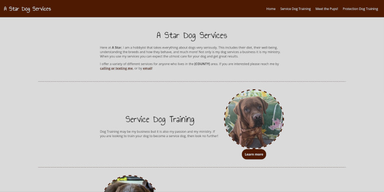

Developed using [11ty/Eleventy](https://www.11ty.dev/) along with regular CSS and some JavaScript to allow clicking on an image to zoom in. In the offline demo I stripped out personal details for privacy.

Fun fact: this was originally made in WordPress as I thought mom was going to maintain the website herself with posting updates before realizing she wanted me to do that for her. I even made a custom block and a custom theme for the site. Unfortunately I do not have the source code for that to show.

### [Demo](https://boundothewitch.github.io/moms-site/)

### [Source](https://github.com/boundothewitch/moms-site)