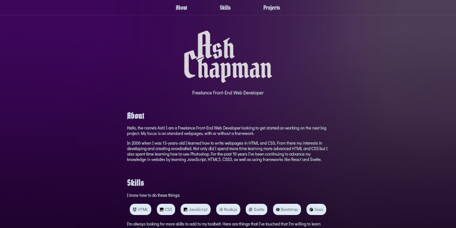

If you came here from my portfolio site then you probably already know that this was made using Svelte and Vite, which was then made into a static site so it could be uploaded to GitHub Pages.

The reason for using Svelte as opposed to something like HTML and CSS by itself was because I love making modular components, and because I love using Svelte too. I didn't want to go overboard on the website, but I also didn't want to undersell it.

### [Site](https://boundothewitch.github.io/)

### [Source](https://github.com/boundothewitch/boundothewitch.github.io)